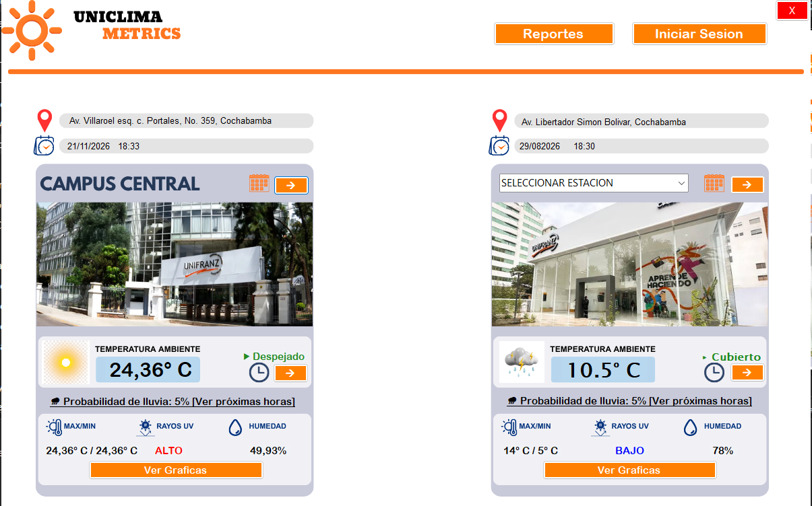
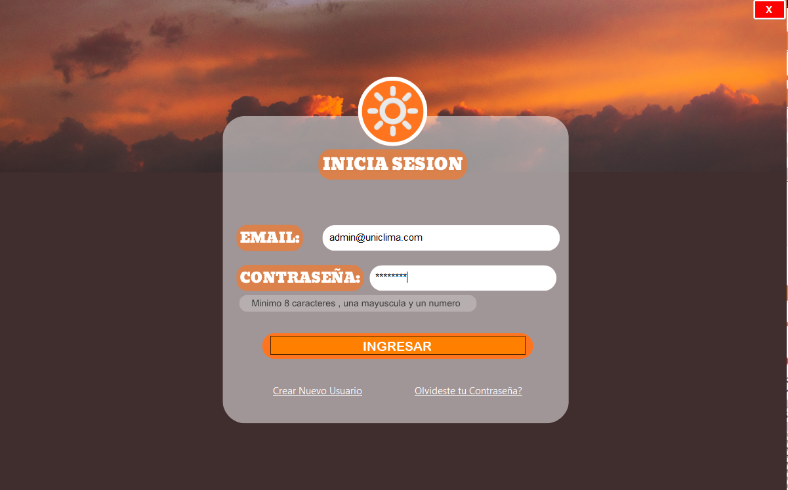
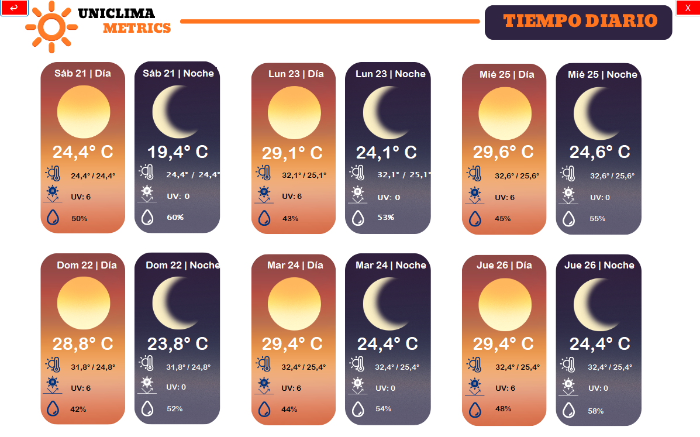
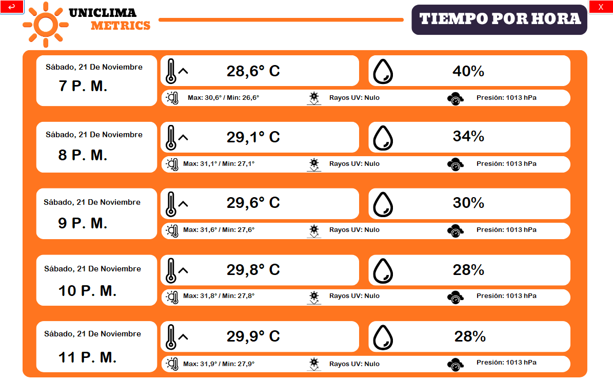
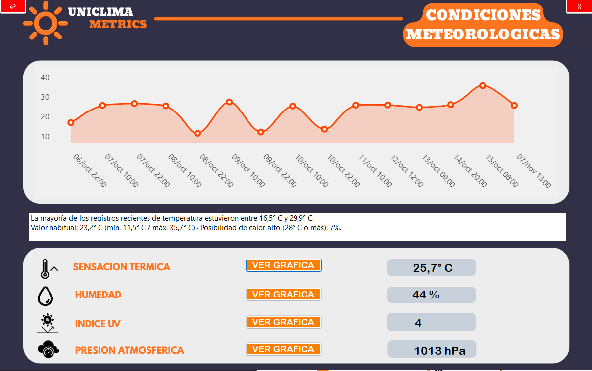
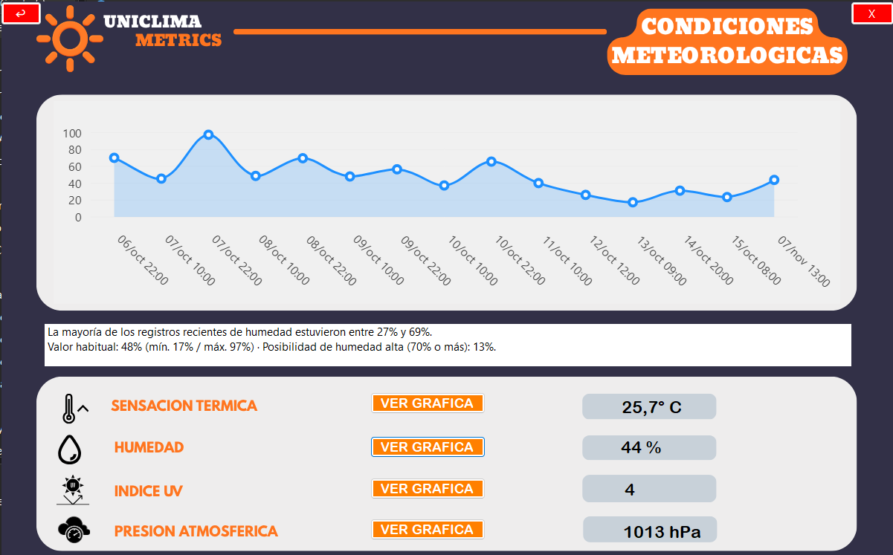
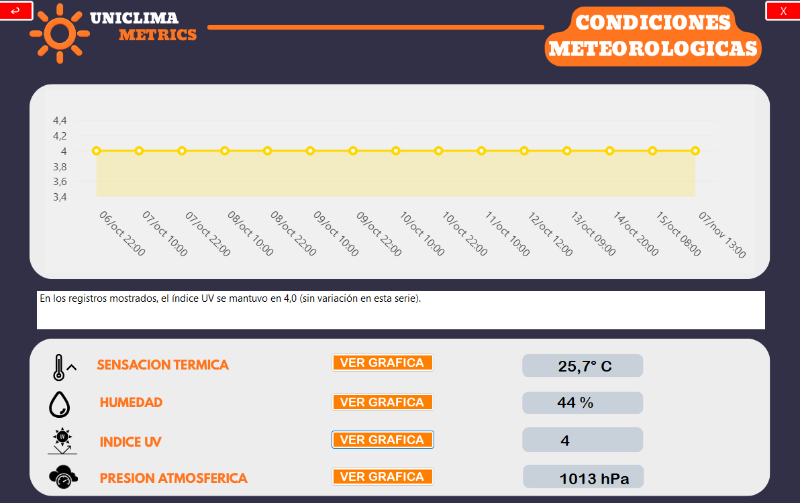

# Evidencias del sistema UNICLIMA METRICS

Esta carpeta reúne capturas de pantallas del sistema para mostrar sus módulos y el funcionamiento de la aplicación.

## Capturas

### 1. Pantalla principal y selección de campus

### 2. Inicio de sesión

### 3. Pronóstico del tiempo diario

### 4. Consulta del tiempo por hora

### 5. Métricas históricas de temperatura

### 6. Métricas históricas de humedad

### 7. Visualización del índice UV

> Las capturas documentan la interfaz y los resultados visibles en el momento en que fueron tomadas. Para interpretar los cálculos estadísticos y su alcance, consulta [la documentación de Probabilidad y Estadística](../docs/probabilidad-estadistica.md).
